# FUNDRAISING-2 · the walk (29 Oct 2026)

Two orgs on the local scratch stack, at 1440 and 390: **demo** (Harborlight, seeded by
`scripts/seed-demo.js`) and **real** (a fresh org with the real-shaped gift history,
the dinner linked to "Finding Joy Dinner", the contacts, and the scrubbed guest list for
attendance, built by `scripts/fundraising2-walk-org.js`). Screens were captured by
`scripts/fundraising2-walk.js`. Before: `before/`. After: `after/`. File names are
`<org>-<screen>-<width>.jpg`.

The real org's numbers: 63 dinner gifts ($45,340), 43 pledges ($78,950 due this fiscal year,
$104,050 over all years), 165 came.

One line per screen; both widths unless a width is named.

## Fundraising · Overview
- demo: "All active goals · 5" above **8** cards, including three ended goals and one not
  started (GivingTuesday, "$0 · 0% · upcoming", with a bar). **Fixed**: "Active goals · 4"
  over 4 running cards, "Starting soon · 1" says "Starts Nov 17, 2026", and Past · 3 is
  folded with each final result.
- demo: "$1,622,663.38" roll-up next to "Active campaigns 4 · $1,771,263.38 raised across
  all". **Fixed**: the Active campaigns tile is gone. The roll-up is the one total, and its
  line says which goals it counts.
- demo: PROJECT / ANNUAL on every card, Offline / Online on every recent gift. **Fixed**:
  no category tag (a goal that rolls others up says "Rolls up N goals"), and a gift says
  its method (Check, Card, Online form, Stripe) or nothing.
- demo: cents on big totals ($1,622,663.38, $1,610,442.92, $701,933.82). **Fixed**: totals of
  $1,000 or more read in whole dollars. Gifts keep their cents.
- demo: Leading campaign card two-thirds empty at 1440. **Fixed**: it says what's left, the
  days left, the pace a week needed, and who gave most this month.
- demo and real: "Everything in Fundraising" repeats the four tabs. **Removed.**
- demo and real: "Gifts this period". **Fixed**: "Gifts this fiscal year".
- real: two "+ Start a campaign" (Start here and Leading campaign), with the dinner nowhere.
  **Fixed**: the lead card shows the Finding Joy Dinner (raised, received, pledged first
  year and all years, came, gave or pledged, came and didn't give, each opening its list),
  and the page has no Start-a-campaign while the event leads.
- real: no pledges anywhere on the Overview. **Fixed**: "Pledged, still to come $104,050 ·
  $78,950 due this fiscal year · $12,550 overdue", each opening its rows.
- real: Recent gifts says "General" for every gift. **Fixed**: the event name when the gift
  has one, otherwise nothing.
- 390: the stat tiles stack one per row, and the lead and recent cards stack. Fine.

## Campaigns & pages
- Campaigns (demo): PROJECT / ANNUAL badges on every campaign card. **Fixed** (the same
  badge). The card copy is otherwise fine. Real: empty state with two templates. Fine.
- Giving pages & forms (demo): four pages "live", and none can take money because the demo
  has no Stripe connection. **Fixed**: each reads "Draft · connect payments to go live",
  "Open page" is hidden, a banner points to Settings → Connections, the Overview's Live
  giving pages is 0, and the public address shows "Not open yet". Real: empty state. Fine.
- Tickets & sponsors: fine (demo and real).
- Auctions: fine. Real empty state fine.
- Peer-to-peer: fine. Real empty state fine.
- Recurring: fine. Real: "1 sustainers from your file". Left: the plural reads wrong; next brief.
- Memberships: fine. Real: "0 Active · 0 Grace…" empty state reads cleanly.

## Major gifts
- At a glance, Pipeline, Proposals, Portfolios, Plans: fine on both. Real empty states say
  what to do.

## Money in
- To confirm (demo): fine. Real: "Nothing is waiting. Every gift that came in as paper…" with
  no pointer to the forward address. **Fixed**: "Nothing to confirm right now. Snap a check
  below, or forward a scan or letter to <address>, and it waits here for you."
- **Pledges (new part)**: every open pledge, with still to come, due this year, overdue, and
  its installments. Its totals equal the Overview, Home and the profiles (truth check).
- Deposits: fine (empty on both).
- Acknowledgments: fine.
- Funds: fine (a pointer to Finance).
- Started, not finished: fine.

## Events (rail)
- real: "Received at events $0" above an event whose page says $45,340 received. **Fixed**:
  it reads each event's own received figure.
- real: "• Other" tag on the event. **Fixed**: "Other" is not a kind of event, so no tag.
- Event page (real): "$124,290 raised ($45,340 received, $78,950 pledged), and $25,100 more
  pledged for later years" was there, but nothing said who gave or who came and didn't give.
  The dark rail's "Event Stats" said "Avg Gift: Not set · Top Donor: Not set", because it
  read amounts typed on guest rows. **Fixed**: the night's story tiles, each opening its
  people, and the Event Stats box is gone.
- Event page: "Registered 263" counts the dinner's 105 givers plus the guest list, so "165
  of 263 registered came" mixes two files. Left for IMPORT-5, which owns came-didn't-give.
- Event page (demo): fine.

## Grants
- Pipeline, Funders, Deadlines, Library, Reports: fine on both.

## Profiles
- A dinner gift's row in Gift History named no event. **Fixed**: the event name under the
  amount.

## Left, and why
- The org-wide donation form (`/give/<org>`) is still reachable with no payments connected.
  Its endpoint also serves the memberships page, and org-blindness's donor-blind check reads
  it, so gating it is its own change. It was never counted under Live giving pages.
- "Registered 263" on the event page: the dinner's givers plus the guest list. IMPORT-5.
- "1 sustainers from your file" on Recurring: the plural. Next brief.
- In the scrubbed fixtures the guest list's names don't match the dinner's givers, so
  "Came, didn't give" equals "Came" (165). The numbers are right for these files; on prod
  the overlap will be real.

## Before and after
| Screen | Before | After |
|---|---|---|
| Overview, demo, 1440 | 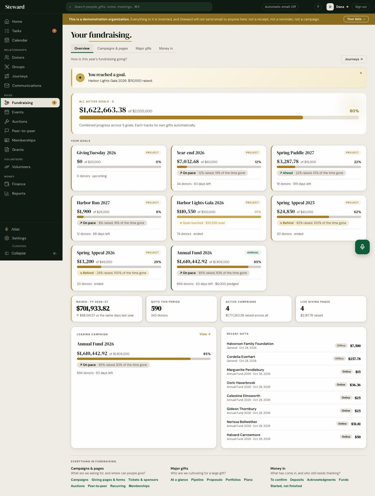 | 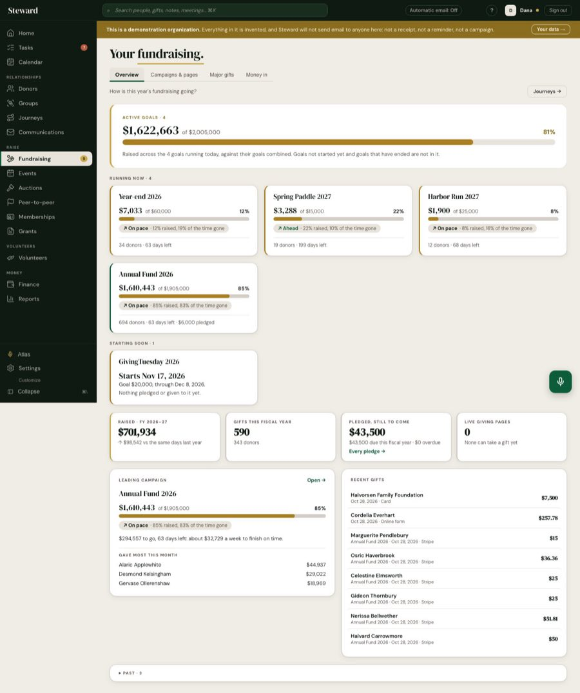 |
| Overview, real, 1440 | 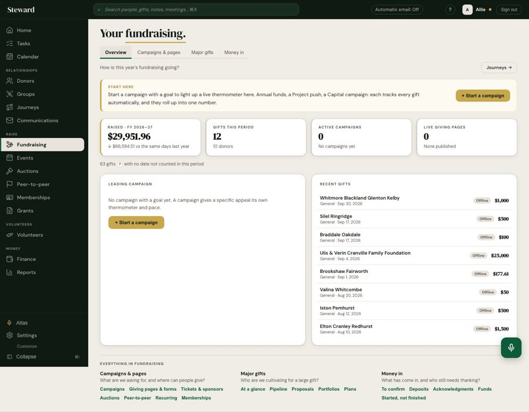 | 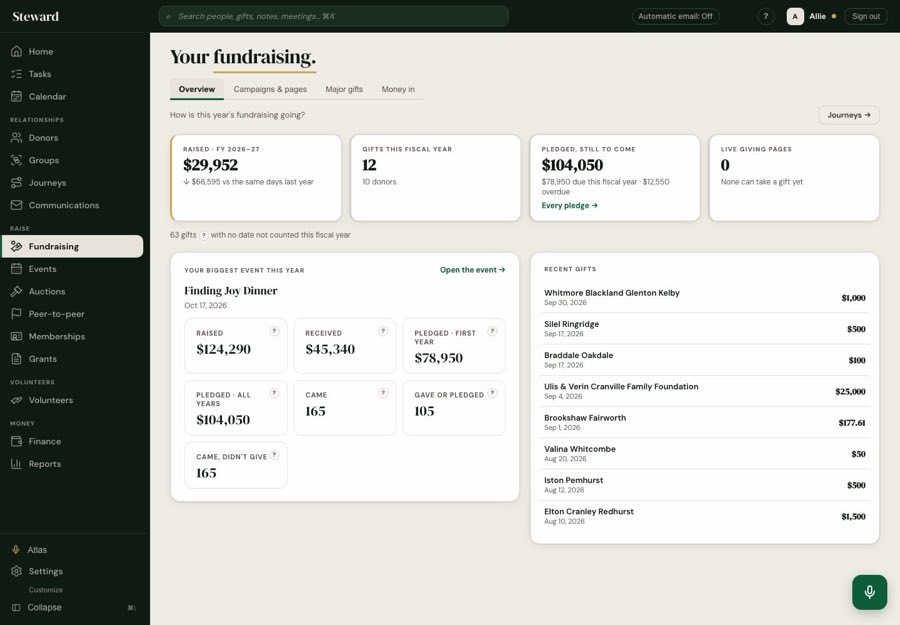 |
| Overview, real, 390 | 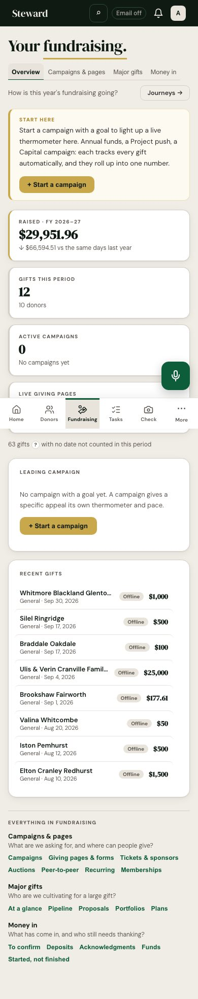 | 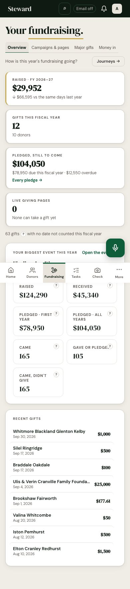 |
| Event page, real, 1440 | 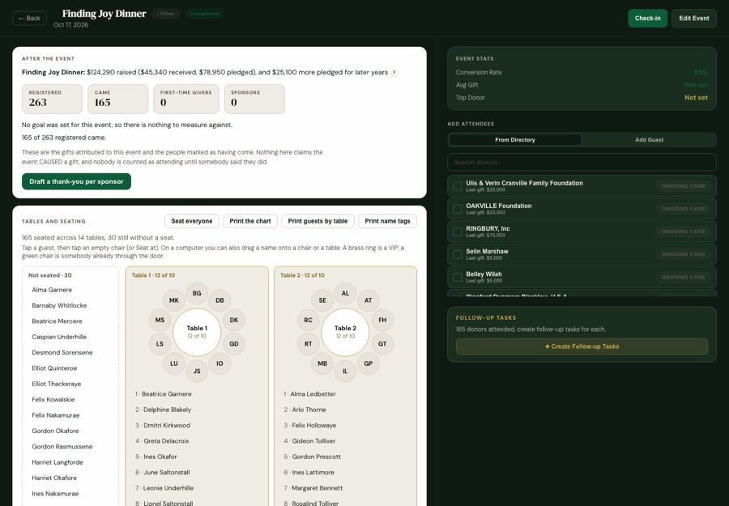 | 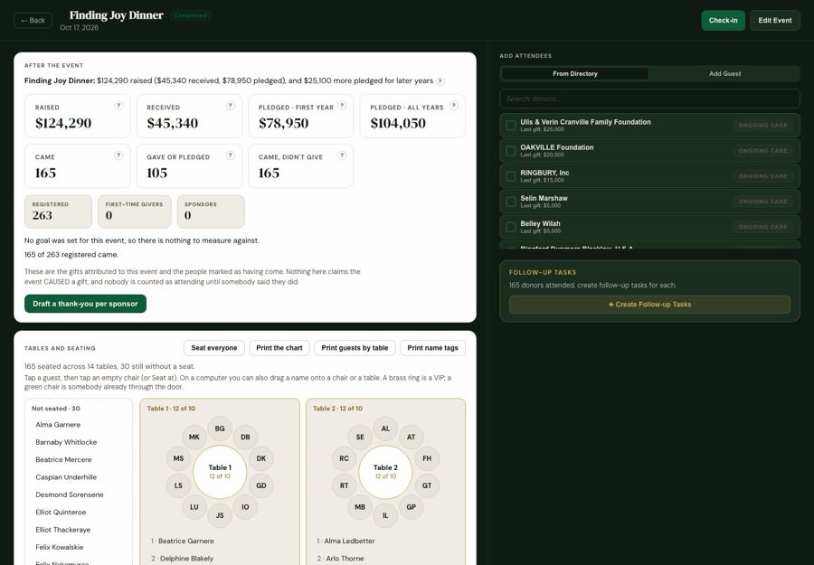 |
| Giving pages, demo, 1440 | 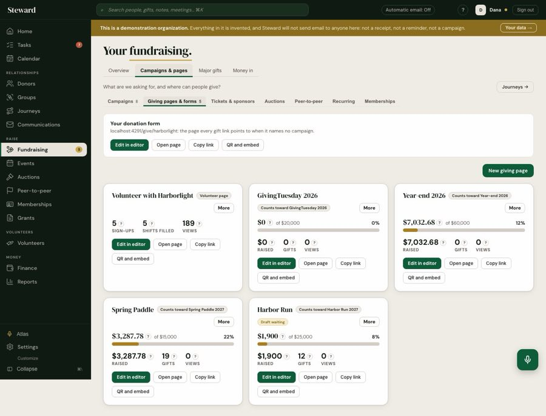 | 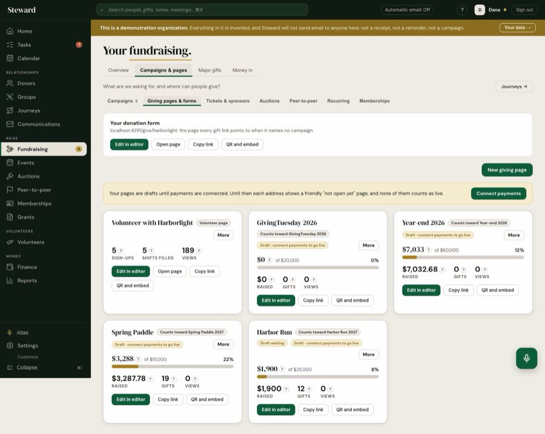 |
| To confirm, real, 1440 | 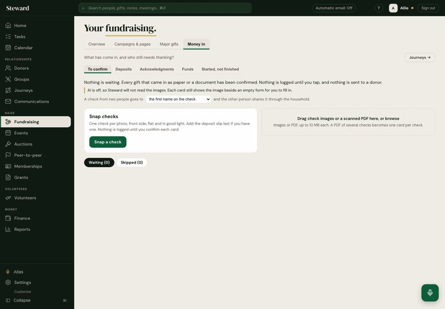 | 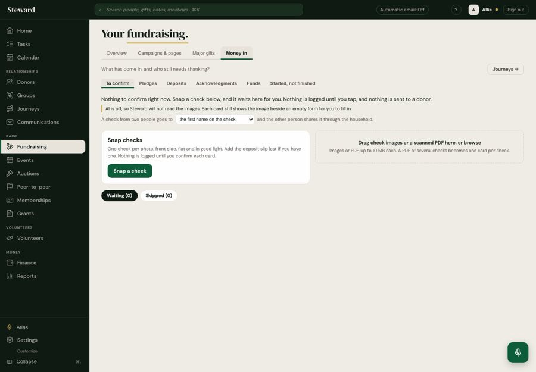 |
| Events, real, 1440 | 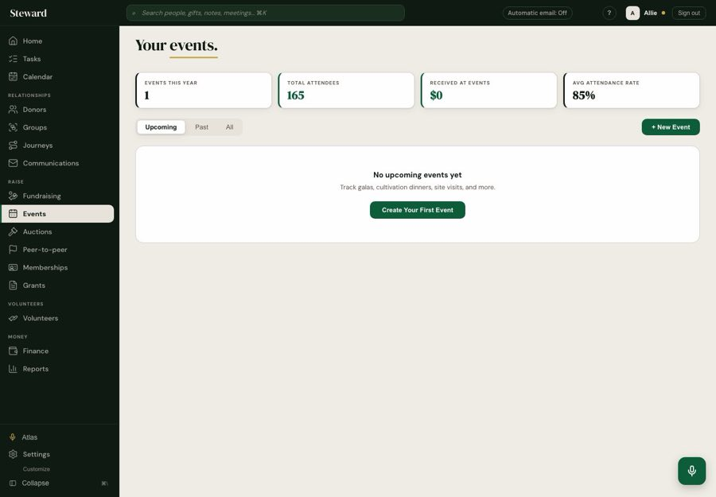 |  |
| Pledges (new), real, 1440 | none | 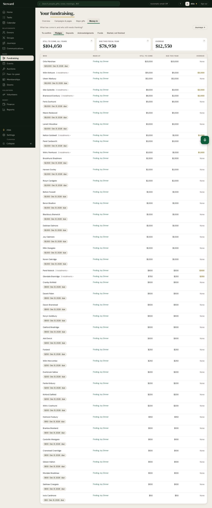 |
